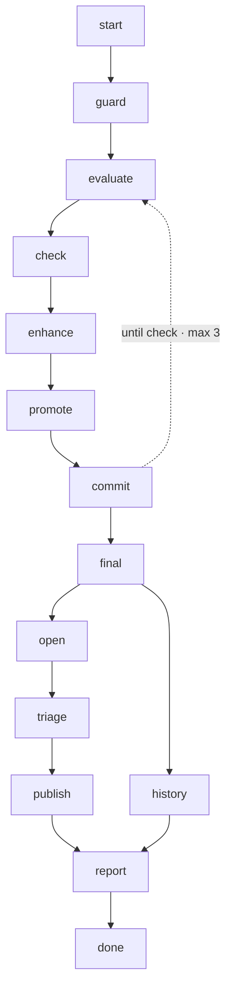

## steps

### guard (depends: start)

run: `{ uv run op eval graph {{entity}} >/dev/null || { echo "entity {{entity}}: no evaluation graph" >&2; exit 1; }; } && { test "$(git branch --show-current)" != main || { echo "on main: run converge from a work branch" >&2; exit 1; }; } && { test ! -e "$(git rev-parse --git-path MERGE_HEAD)" || { echo "a merge is in progress: conclude or abort it" >&2; exit 1; }; } && { git diff --quiet HEAD -- core || { echo "core/ has uncommitted changes:" >&2; git status -s core >&2; exit 1; }; }`

Refuses, naming why, an unknown entity kind, main, a merge in progress, or uncommitted core/: every pass commits on this branch, and the PR is the human's gate.

### evaluate (depends: guard)

run: `uv run op eval run {{entity}} {{ids}} --cadence commit`

### check (depends: evaluate)

run: `uv run op eval needs {{entity}} --owner agent`

The loop's check: exit 0 when no need the agents own is open (closed); otherwise the open set, compared with the last pass.

### enhance (depends: check)

run: `uv run op enhance run {{entity}} --from latest --owner agent --cadence commit`

One integrator session per subject, in turn (they share the sandbox): a pass over many subjects takes minutes each.

### promote (depends: enhance)

run: `uv run op enhance promote --yes --all-verdicts`

Applies every promotable verdict — adopt and propose, never reject or hold: on a skill every gate is green but `promote.skill: none` and the unmeasured probes cap the verdict at propose. Inside this branch that is safe; the PR is the human's gate. Needs the mandate of a human terminal.

### commit (depends: promote)

run: `git add core && (git diff --cached --quiet && echo "nothing to commit" || (git commit -q -m "converge({{entity}}): pass {{iteration}}" && git log -1 --format="%h %s" && git show --stat --format= HEAD))`

The next pass's sandbox clones HEAD: a promotion left uncommitted would be invisible to it.

### final (depends: commit)

run: `uv run op eval run {{entity}} {{ids}} --cadence commit`

The evaluation of what the loop left: every later node reads it as `latest`.

### open (depends: final)

run: `uv run op eval needs {{entity}} || true`

Every need the final evaluation left open, by subject and kind: the triage and the report read it here, never the ledger.

### history (depends: final)

run: `git log --format="%h %s" --grep="^converge({{entity}}): pass" main..HEAD && git diff --stat main...HEAD -- core`

The commits converge made on this branch (by their subject), and every core/ file the branch moves over main.

### triage (depends: open)

@auditor The open needs are in the `open` step's output above; read nothing else to find them. If none is a `security` need, answer "nothing to triage" in one line and stop. Otherwise read only the core/ line each finding names, and class it as real (the text instructs harm), quality (the scanner could not read it whole) or false positive (the text names, forbids or documents the threat), with one line of evidence. For each false positive, write the `core/tekton/config/security.yaml` entry a human would add — fingerprint, file, why — as a proposal only: you never edit that file.

### publish (depends: triage)

*only when `publish` is `true`*

run: `git push -q -u origin HEAD && (gh pr view >/dev/null 2>&1 || gh pr create --fill)`

### report (depends: publish, history)

Assemble the run's output only from the step outputs above — do not explore the repository: how many passes ran and why the loop ended (the `check_<k>` outputs: closed, stalled, or out of passes); each pass's verdicts per subject and their reasons, read verbatim from `enhance_<k>` (adopt · propose · reject · hold · settled), and what `promote_<k>` applied — a verdict not listed under `applied` was not promoted, say which and why; the commits (`history`); the needs still open, split into the agents' and yours (`open`); the triage's classes and proposed security.yaml entries; and the exact commands left to the human (accept the proposals, review `git diff main...HEAD`, run again with publish=true or merge). Name every step skipped and why.

## loop

Repeat `evaluate` → `check` → `enhance` → `promote` → `commit` at most 3 times. `check` ends it: its command exits 0 (closed), or prints the same open set as the previous iteration (stalled). After an ending check every remaining step of the loop is skipped and the run continues past it. `{{iteration}}` is the current pass, from 1.

## output

type: report
path: session
