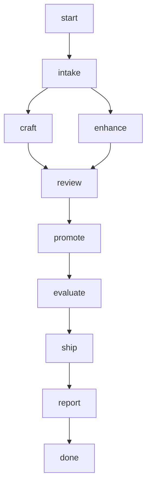

## steps

### intake (depends: start)

run: `uv run op eval graph {{entity}}`

Validates that the entity kind has an evaluation graph; an unknown kind fails here and stops the run.

### craft (depends: intake)

*only when `op` is `create` or `retire`*

@builder {{op}} the {{entity}} `{{id}}` in core/ as {{details}} describes, by the law of its kind (flow-gen-lifecycle, references/<kind>.md). create: the manifest and its sources, budgets first, one sample last. retire: grep the id across core/, specs/ and ops/evaluator/ledgers/, remove every pointer, then delete the source. Edit core/ only. Return the paths changed.

### enhance (depends: intake)

*only when `op` is `update`*

run: `uv run op enhance run {{entity}} {{id}} --directive "{{details}}" --cadence commit`

### review (depends: craft, enhance)

@auditor Review the change before it is promoted. update: read the enhancer run the enhance step names (`uv run op reports show <that id>`) and the patch under .reports/<that id>/patches/; create or retire: read `git diff -- core/`. Check it against the details ({{details}}) and the house law of the kind. Return findings classified blocking / advisory; a blocking finding must name the file and line.

### promote (depends: review)

*only when `publish` is `true`*

*only when `op` is `update`*

run: `uv run op enhance promote --yes --ids {{id}}`

### evaluate (depends: promote)

run: `uv run op eval run {{entity}} {{id}} --cadence commit`

### ship (depends: evaluate)

*only when `publish` is `true`*

run: `uv run op transpiler apply --yes --note workflow:emaintenance`

### report (depends: ship)

Assemble the run's output: entity, op, id; paths changed (craft) or the enhancement's verdict and patch; review findings; the evaluation's needs after the change; ship's result, or the exact commands left to the human (`op enhance promote --ids {{id}}`, `op transpiler plan`, `op transpiler apply`). Name every step skipped and why.

## output

type: report
path: session
