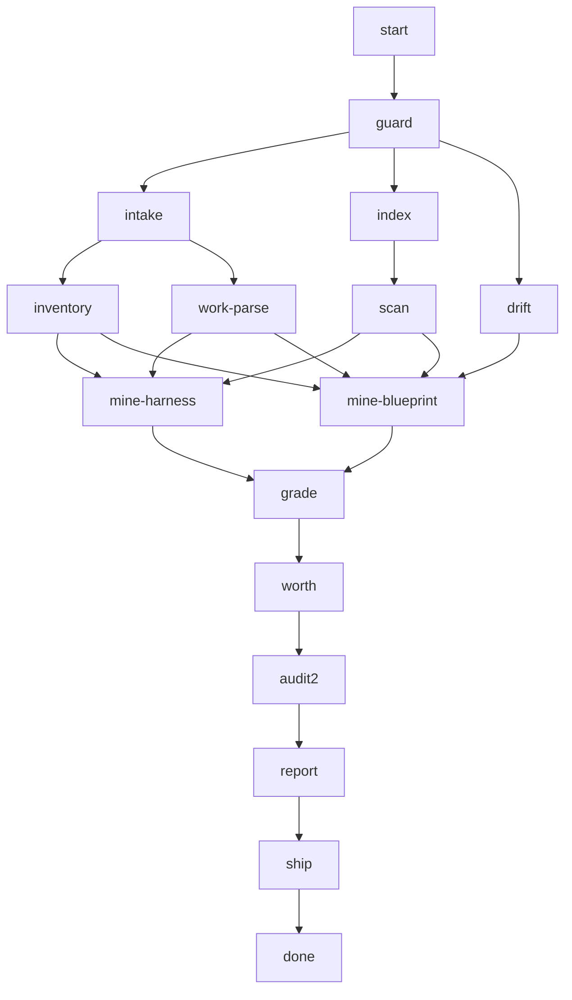

## steps

### guard (depends: start)

run: `uv run op distill guard --rundir {{rundir}} --project "{{project}}" --branches "{{branches}}" --since "{{since}}" --work "{{work}}"`

Fixes the scope; exit 3 when no branch carries a commit past its base — every later step is skipped, zero tokens.

### intake (depends: guard)

run: `uv run op distill intake --rundir {{rundir}}`

Every commit since the base and every file it touched, weighed and classed.

### index (depends: guard)

run: `uv run op distill index --rundir {{rundir}}`

e-nous, e-arkhetypo and the project made current in the code graph (incremental; a core that did not move costs nothing).

### scan (depends: index)

run: `uv run op distill scan --rundir {{rundir}}`

The files the branches changed and the symbols the code graph says they impact.

### drift (depends: guard)

run: `uv run op distill drift --rundir {{rundir}}`

Where the project departs from the blueprint it materialized, as its own core-check and common-check say.

### inventory (depends: intake)

run: `uv run op distill inventory --rundir {{rundir}}`

Every plane, without a model: the project's dependencies against every skill's lib.md, its core-layer modules and shared files against system core, the services it runs against the stack, its packages against the systems, the MCP it serves against the coders' wiring, its Make targets, CI and folders against the blueprint. One fact per thing the cores lack or say differently; fresh when it arrived in the run's range.

### work-parse (depends: intake)

@researcher Read {{rundir}}/distill/manifest.json: the commits of the run and, in scope.work, what the human says was done and learned. Turn it into claims — each one statement of something learned, of kind discovery, improvement, contradiction, benchmark or one_off (a need of this project alone), with its evidence (commit sha and message, code path, benchmark numbers, a source url). Merge what says the same; leave out chores, version bumps and formatting. Answer with one ```json block: an array that fits ops/schemas/Claims.json, ids k1, k2, …

### mine-harness (depends: scan, work-parse, inventory)

@scout-codegraph Mine candidate changes to e-nous (its graph project is in {{rundir}}/distill/indexes.json; only core/ and specs/tekton/ are doctrine) on its four planes. doctrine — a skill's rules or references; library — a skill's lib.md; process — an agent, command or workflow; tooling — the stack and the MCP wiring. Your inputs: the claims of work-parse, the delta in {{rundir}}/distill/deltas.json and the facts in {{rundir}}/distill/inventory.json (its `stale` list is the project's own drift, never a candidate). A diverged fact carries `direction` and `base`: `ahead` or `both` means the project moved since it copied the template; what it added is the project's file against `git show <base>:<template path>` in e-arkhetypo, not against the template's tip. Go through every fresh fact of plane library and tooling: a library goes to the lib.md of the skill whose domain it serves (search the graph for that skill), an unwired MCP to the core's MCP config; propose it or leave it, but decide. Then every claim the core does not already say (search for the skill, reference, agent, command or workflow it concerns). Each candidate: a one-line `title` (≤80 characters, the change itself), its targets (facet, entity, id, part, name, and per target its change — create, update or retire), its relation, a one-paragraph sketch, the evidence, the claim ids and the fact ids it answers. A claim of kind one_off proposes nothing. At most 12. Every fresh fact of your planes you do not answer goes to `waived` with its reason in one sentence. Answer with one ```json block: an object that fits ops/schemas/Mining.json.

### mine-blueprint (depends: scan, drift, work-parse, inventory)

@scout-codegraph Mine candidate changes to e-arkhetypo (its graph project is in {{rundir}}/distill/indexes.json) on its five planes. module — system core's adapters, core, ops, processors; common — system core's shared project files; system — a system, or a new one; service — a stack service, or a new one; ops — infra, management, tools. Your inputs: the claims of work-parse, the delta in {{rundir}}/distill/deltas.json, the drift in {{rundir}}/distill/drift.json and the facts in {{rundir}}/distill/inventory.json (its `stale` list is the project's own drift, never a candidate). A diverged fact carries `direction` and `base`: `ahead` or `both` means the project moved since it copied the template; what it added is the project's file against `git show <base>:<template path>` in e-arkhetypo, not against the template's tip. Go through every fresh fact of those planes: a module absent from system core that any other project would want, a diverged module whose change fixes or widens the template, a service the stack lacks, a package that is a system's worth, a Make target or folder every project should carry; propose it or leave it, but decide — a fact that serves only this project is no candidate. Then every claim the templates do not already serve. Each candidate: a one-line `title` (≤80 characters, the change itself), its blueprint targets (area, unit, new, layer, path, and per target its change — create, update or retire), relation, a one-paragraph sketch, the evidence, the claim ids and the fact ids it answers. At most 12. Every fresh fact of your planes you do not answer goes to `waived` with its reason in one sentence. Answer with one ```json block: an object that fits ops/schemas/Mining.json.

### grade (depends: mine-harness, mine-blueprint)

run: `uv run op distill grade --rundir {{rundir}}`

Reads both miners' answers through the Candidate model (an answer that does not fit fails here), merges them and weighs each — matrix grade, existence on disk, reach, recent change on the same place; an incoherent target, a missing place or an unjudged slot stops the candidate before any model weighs it.

### worth (depends: grade)

@auditor-verdict Judge every candidate of {{rundir}}/distill/candidates.json whose grade in {{rundir}}/distill/grades.json has no stop: must, should, case or reject, with its generality in [0, 1] and a rationale citing the evidence and the matrix grade you weighed. Ask of each: is this today's case, or tomorrow's rule? Answer with one ```json block: an array that fits ops/schemas/Judgements.json, one item per candidate judged.

### audit2 (depends: worth)

@verifier-adversary Try to sink every judgement of worth whose verdict is must or should, with the candidate's own evidence and the code graph: evidence that does not say what is claimed, a counter-case elsewhere, the core already saying it. Answer with one ```json block: an array that fits ops/schemas/Reviews.json, one item per must or should — upheld true with an empty objection only when it survived every attack; otherwise the objection and the final verdict (case or reject) it drops to.

### report (depends: audit2)

run: `uv run op distill report --rundir {{rundir}}`

Joins verdicts and reviews to the graded candidates and writes report.json and report.md without a model: coverage per plane, proposals with the command that applies each (its brief in briefs/), the case ledger, what was rejected or stopped, and every fact no candidate answered. Nothing is applied here.

### ship (depends: report)

*only when `apply` is `true`*

run: `uv run op distill ship --rundir {{rundir}}`

Runs, in order, the emaintenance commands that apply the musts; the shoulds stay in report.md for the human.

## output

type: report
path: <rundir>/report.md · <rundir>/distill/report.json
