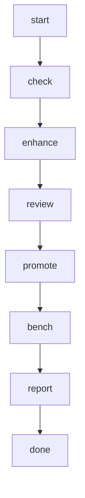

## steps

### check (depends: start)

run: `uv run op eval run spec {{backend}} --cadence nightly`

### enhance (depends: check)

run: `uv run op enhance run spec --from latest --cadence nightly`

### review (depends: enhance)

@auditor Read the enhancer run the enhance step names (`uv run op reports show <that id>`) and every patch under .reports/<that id>/patches/spec/. For each spec row changed, confirm the cited source says it (open it); flag rows that promote a spec to ready without every source read, and rows the signals did not ask for. Return findings classified blocking / advisory. Read files with the read and glob tools; the shell is for `uv run op …`.

### promote (depends: review)

*only when `publish` is `true`*

run: `uv run op enhance promote --yes`

### bench (depends: promote)

*only when `publish` is `true`*

run: `uv run op transpiler bench`

### report (depends: bench)

Report per backend: signals found, spec rows changed with their verdict and grade, review findings, what was promoted, the bench result; and what is left to the human (`op transpiler plan`, `op transpiler apply`).

## output

type: report
path: session
